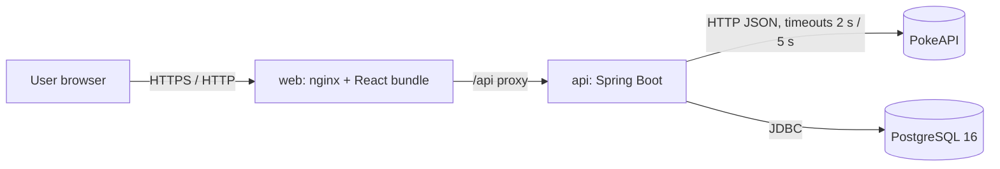
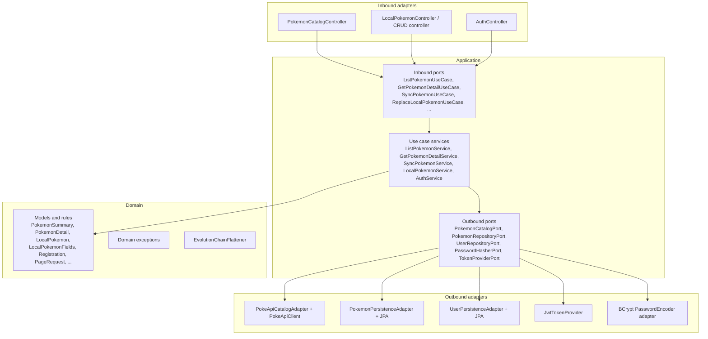
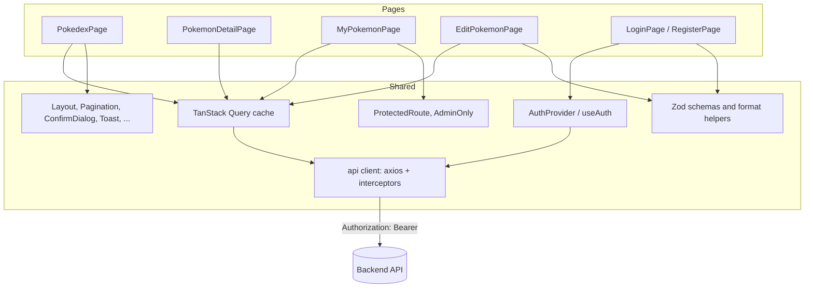
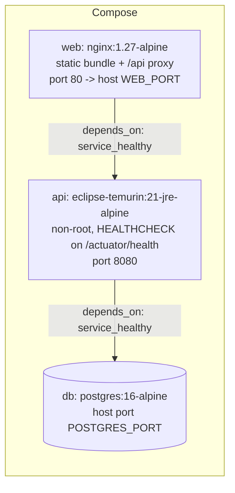

# Technical Overview

This document describes the structure of the Pokédex system, the architecture chosen and the reasons for that choice, and how the backend, the frontend and the delivery pipeline are implemented.

## 1. Scope

The system exposes a catalogue of Pokémon obtained from the public PokeAPI, a local copy of that data in a relational database, and a set of user-owned fields that can be edited. It consists of:

- A **backend API** (Java 21, Spring Boot 3.5.9) that implements the use cases, persistence, caching and authentication.
- A **frontend single-page application** (React 18, TypeScript, Vite) that consumes the API.
- A **container stack** (Docker Compose) composed of PostgreSQL 16, the API and an nginx instance serving the frontend and proxying `/api`.

Functional requirements are traced to tasks in `.claude/planning/planification.md`.

## 2. System context



In development, the Vite dev server (port 5173) replaces nginx and forwards `/api` to the backend.

## 3. Repository layout

```
backend/                 Maven project (Java 21, Spring Boot 3.5.9)
  src/main/java/.../
    domain/              models, value rules, domain exceptions, pure services
    application/         inbound ports, outbound ports, use case services
    infrastructure/      adapters (web, PokeAPI, persistence), security, configuration
  src/main/resources/
    db/migration/        schema migrations (V1 baseline, V2 catalogue, V3 users)
    db/seed/             demo data (V4 users, V5 Pokémon), loaded only in local and docker profiles
frontend/                Vite project (React 18, TypeScript, Tailwind CSS 4)
  src/api/               HTTP client and typed API modules
  src/auth/              session context, guards, token helpers
  src/components/        presentational and shared components
  src/features/          validation schemas, formatting helpers
  src/pages/             route-level screens
docs/api.http            example requests for every endpoint
.claude/                 planning, decisions and verification records
docker-compose.yml       db, api, web
.github/workflows/ci.yml backend and frontend CI jobs
```

## 4. Backend architecture

### 4.1 Architectural style

The backend follows a **hexagonal architecture** (ports and adapters). Dependencies point inward: adapters depend on ports, ports and use cases depend on the domain, and the domain depends on nothing outside itself.



The `domain` package has no framework imports. The `application` package has no framework imports either; Spring is used only in `infrastructure`, which wires the use cases with `@Configuration` classes.

### 4.2 Justification

| Decision | Reason | Trade-off |
| --- | --- | --- |
| Hexagonal architecture | The business rules (validation of own fields, pagination limits, evolution flattening, sync semantics) must be testable without a database, a web server or the network. | More types and mappings than a layered CRUD design. |
| Framework-free core | Use cases are plain Java classes constructed by configuration. Unit tests run in milliseconds and do not load a Spring context. | Configuration classes must construct every service explicitly. |
| Ports named by direction | Controllers depend only on inbound ports; the PokeAPI client and the JPA repository are replaceable behind outbound ports. | Each external integration needs an interface plus an adapter. |
| Immutable domain records | Value semantics avoid accidental mutation and make equality and tests predictable. Updates produce new instances (`withOwnFields`, `withBaseData`). | Copies on every update; acceptable for this data volume. |
| Separate persistence model | The JPA entity (`PokemonEntity`) differs from the domain record. Persistence annotations never leak into the domain. | A hand-written mapper (`PokemonEntityMapper`) must be kept in sync. |

Architectural rules are enforced by **ArchUnit** tests (`ArchitectureTest`):

1. `domain` does not depend on `application` or `infrastructure`.
2. `domain` and `application` do not depend on `org.springframework..`, `jakarta.persistence..` or `com.fasterxml..`.
3. Classes in `adapter.in.web` do not depend on `adapter.out..`, `persistence` or `pokeapi` packages.

A violation fails the build.

### 4.3 Use cases

| Use case | Port (in) | Behaviour |
| --- | --- | --- |
| Catalogue listing | `ListPokemonUseCase` | Validates `page ≥ 0` and `1 ≤ size ≤ 50`, delegates to `PokemonCatalogPort.findPage`. |
| Detail | `GetPokemonDetailUseCase` | Normalises the identifier (trim, lowercase), requests the description in English, maps absence to `PokemonNotFoundException`. |
| Sync (single) | `SyncPokemonUseCase.sync` | Upsert by `pokeApiId`. Refreshes base data only; never overwrites `localName`, `region`, `tags`. Returns `created` flag. |
| Sync (range) | `SyncPokemonUseCase.syncRange` | At most 151 ids per call. Per-item failures are collected; the batch continues. |
| Create local | `CreateLocalPokemonUseCase` | Requires that the id exists in PokeAPI and is not yet stored; base data comes from PokeAPI, own fields from the user. |
| Replace (PUT) | `ReplaceLocalPokemonUseCase` | Replaces all own fields. If `expectedVersion` is supplied and differs, raises `ConcurrentModificationException`. |
| Patch (PATCH) | `PatchLocalPokemonUseCase` | Applies only the fields present in the request; an explicit `null` clears an optional field. An empty patch is rejected. |
| List / get / delete | `ListLocalPokemonUseCase`, `GetLocalPokemonUseCase`, `DeleteLocalPokemonUseCase` | Filtered, paginated listing (name, region, tag); lookup; delete. |
| Register / login / current user | `RegisterUserUseCase`, `LoginUseCase`, `CurrentUserUseCase` | See §6. |

### 4.4 Domain model

- `LocalPokemonFields` is the value object for user-owned data. Its constructor normalises (trim, lowercase tags) and validates all rules at once, reporting every violation in a single `InvalidPokemonDataException`.
- `LocalPokemon` separates **base data** (`name`, `spriteUrl`, `category`, `height`, `weight`, `types`, `abilities`) from **own fields** (`localName`, `region`, `tags`). The method `withBaseData` is the only way the sync path changes base data, so the separation is structural rather than conventional.
- `Registration` validates sign-up data (username `[a-z0-9_]{3,50}`, email, password 8–72 characters with a letter and a digit).
- `EvolutionChainFlattener` converts the PokeAPI evolution tree, including branches, into an ordered list of stages by depth.
- `FieldPatch<T>` represents a partial update of one field with three states: absent, present with a value, present and explicitly `null`.

Domain exceptions extend `DomainException`. The web adapter maps each subtype to an HTTP status (§5.3).

### 4.5 Integration with PokeAPI

`PokeApiClient` wraps `RestClient` with:

- Base URL from `pokedex.pokeapi.base-url` (default `https://pokeapi.co/api/v2`).
- Connect timeout 2 s and read timeout 5 s, configured through `SimpleClientHttpRequestFactory`.
- HTTP 404 mapped to `Optional.empty()`; any other error or timeout mapped to `ExternalServiceException` (HTTP 502 to the client).
- Transport records (`PokeApiDtos`) annotated with `@JsonIgnoreProperties(ignoreUnknown = true)`, so new upstream fields do not break deserialisation.

`PokeApiCatalogAdapter` implements `PokemonCatalogPort`. To build one catalogue page it first requests the list, then loads the detail and species of every item **in parallel** on a virtual-thread executor (`Executors.newVirtualThreadPerTaskExecutor()`). Failures inside the parallel calls are re-thrown as domain exceptions.

Description language is requested as `en` only.

### 4.6 Caching

Caffeine caches are configured in `CacheConfig` with a shared TTL (`pokedex.cache.ttl`, default 10 minutes) and maximum size (`pokedex.cache.max-size`, default 1000):

| Cache | Annotated method | Purpose |
| --- | --- | --- |
| `pokemonPage` | `PokeApiCatalogAdapter.findPage` | Catalogue pages |
| `pokemonDetail` | `PokeApiCatalogAdapter.findDetail` | Detail responses |
| `species` | `PokeApiClient.getSpecies` | Species documents shared across details |
| `evolutionChain` | `PokeApiClient.getEvolutionChain` | Evolution chains shared across species |

Caching is applied only in infrastructure. `CachingConfigurationTest` verifies with WireMock that a second identical call does not reach PokeAPI.

### 4.7 Persistence

- **Database**: PostgreSQL 16. Schema managed by Flyway; Hibernate runs with `ddl-auto: validate`, so the entity model and the schema must agree or startup fails.
- **Schema**: `pokemon` (unique `pokeapi_id`, `@Version` column, timestamps), `pokemon_type`, `pokemon_ability`, `pokemon_tag` (element collections with `@OrderColumn`, primary key `(pokemon_id, position)`), `users` (unique `username` and `email`, role check constraint).
- **Concurrency**: optimistic locking through `@Version`. `OptimisticLockingFailureException` is translated to `ConcurrentModificationException`; `DataIntegrityViolationException` on insert is translated to `DuplicateResourceException`.
- **Transactions**: `PokemonPersistenceAdapter` is `@Transactional` at class level and read-only for queries. Mapping reads element collections, so mapping must happen inside the transaction (`open-in-view` is disabled).
- **Search**: a single JPQL query with bound parameters where the empty string means "no filter". Name matches `name` or `localName`; region and tag are case-insensitive.

Migration sequence:

| Script | Location | Content |
| --- | --- | --- |
| `V1__baseline.sql` | `db/migration` | Baseline; validates the connection |
| `V2__create_pokemon.sql` | `db/migration` | Catalogue tables and indexes |
| `V3__create_users.sql` | `db/migration` | Users table |
| `V4__seed_users.sql` | `db/seed` | Demo accounts (BCrypt hashes) |
| `V5__seed_pokemon.sql` | `db/seed` | Pokémon #1–#20 with base data and some own fields |

Seed scripts are added to the Flyway locations only by the `local` and `docker` profiles. Tests run on a clean schema.

## 5. Web layer and API contract

### 5.1 Endpoints

| Method | Path | Access | Status codes |
| --- | --- | --- | --- |
| GET | `/api/v1/pokeapi/pokemon?page&size` | Public | 200, 400, 502 |
| GET | `/api/v1/pokeapi/pokemon/{idOrName}` | Public | 200, 404, 502 |
| GET | `/api/v1/pokemon?page&size&name&region&tag` | Public | 200, 400 |
| GET | `/api/v1/pokemon/{id}` | Public | 200 (with `ETag`), 404 |
| POST | `/api/v1/pokemon` | Authenticated | 201 (`Location`, `ETag`), 400, 404, 409 |
| PUT | `/api/v1/pokemon/{id}` | Authenticated | 200 (`ETag`), 400, 404, 409 |
| PATCH | `/api/v1/pokemon/{id}` | Authenticated | 200 (`ETag`), 400, 404 |
| DELETE | `/api/v1/pokemon/{id}` | ADMIN | 204, 403, 404 |
| POST | `/api/v1/pokemon/sync/{idOrName}` | Authenticated | 201 (created) or 200 (refreshed), 404, 502 |
| POST | `/api/v1/pokemon/sync?from&to` | ADMIN | 200, 400 |
| POST | `/api/v1/auth/register` | Public | 201, 400, 409 |
| POST | `/api/v1/auth/login` | Public | 200, 401 |
| GET | `/api/v1/auth/me` | Authenticated | 200, 401 |

Optimistic concurrency works as follows: the `ETag` of a read is the entity version in quotes (`"3"`). A client sends it back as `If-Match` on PUT. A mismatch returns 409.

### 5.2 Request handling

Controllers are thin: they convert DTOs to domain values and call an inbound port. Request DTOs carry Bean Validation annotations (`@NotBlank`, `@Size`, `@Positive`). Field rules that depend on domain logic are enforced by the domain value objects, so a rule has a single definition. Unknown JSON properties are rejected (`fail-on-unknown-properties: true`).

### 5.3 Error model

All error responses use **RFC 7807 `ProblemDetail`**. `ApiExceptionHandler` maps:

| Source | HTTP status |
| --- | --- |
| `InvalidPaginationException`, `InvalidPokemonDataException`, `InvalidUserDataException`, validation errors, malformed body, wrong parameter type, missing parameter | 400 |
| `InvalidCredentialsException` | 401 |
| `AccessDeniedException` (rethrown so Spring Security returns 403) | 403 |
| `PokemonNotFoundException`, `UserNotFoundException`, unknown path | 404 |
| `HttpRequestMethodNotSupportedException` | 405 |
| `HttpMediaTypeNotSupportedException` | 415 |
| `DuplicateResourceException`, `ConcurrentModificationException` | 409 |
| `ExternalServiceException` | 502 |
| Any other exception | 500 with a generic message |

Field-level errors are returned in an `errors` array (`field`, `message`). Every body includes a `correlationId`, taken from the `X-Correlation-Id` header or generated by `CorrelationIdFilter` and stored in MDC. A 500 never exposes the stack trace; the trace is logged with the correlation id.

### 5.4 Documentation

springdoc-openapi generates the OpenAPI description. Swagger UI is available at `/swagger-ui.html`. Operations are annotated with summaries and response codes.

## 6. Security

### 6.1 Mechanism

- **Stateless** Spring Security filter chain: no `HttpSession`, CSRF disabled (the API uses bearer tokens, not cookies).
- **Tokens**: JWT signed with HS256 (JJWT 0.12). Claims: `sub` (username), `role` (`USER` or `ADMIN`), `iat`, `exp`. Lifetime from `pokedex.security.jwt-expiration-minutes` (default 60).
- **Filter**: `JwtAuthenticationFilter` reads `Authorization: Bearer <token>`, verifies signature and expiry through `TokenProviderPort`, and sets an authentication with authority `ROLE_<role>`. Invalid or expired tokens leave the request anonymous, which yields 401 through the entry point.
- **Secret**: `pokedex.security.jwt-secret` must be at least 32 bytes. `JwtTokenProvider` refuses to start otherwise. In the `docker` profile the variable has no default, so startup fails when it is missing.
- **Passwords**: BCrypt (Spring Security `BCryptPasswordEncoder`) behind `PasswordHasherPort`.
- **Method security**: `@EnableMethodSecurity`; `DELETE` and the bulk sync require `hasRole('ADMIN')`.
- **Login errors**: an unknown username and a wrong password produce the same `InvalidCredentialsException`, so the response does not reveal which account exists.

### 6.2 Access rules

Public: `POST /api/v1/auth/register`, `POST /api/v1/auth/login`, `GET` on the catalogue and the local listing, `GET /actuator/health`, API documentation, and `/error` (so that an error dispatch keeps its status). Every other request requires authentication.

### 6.3 CORS

Allowed origins come from `pokedex.cors.allowed-origins`. Allowed methods are `GET, POST, PUT, PATCH, DELETE, OPTIONS`. Allowed request headers include `Authorization`, `If-Match` and `X-Correlation-Id`; exposed response headers include `ETag` and `Location`. In Docker the browser reaches the API through nginx on the same origin, so CORS applies only to the development setup.

## 7. Frontend architecture

### 7.1 Stack

React 18.3 · TypeScript (strict) · Vite 6 · React Router 7 · TanStack Query 5 · React Hook Form with Zod 4 · axios · Tailwind CSS 4 · Vitest 4 with Testing Library and MSW.

### 7.2 Module structure



- `src/api/` contains one module per resource (`catalog.ts`, `local.ts`, `auth.ts`) with typed functions. Response types mirror the backend records (`types.ts`).
- `src/api/client.ts` owns the axios instance. Its request interceptor adds the bearer token; its response interceptor converts errors to `ApiError`, which carries `status`, the parsed `ProblemDetail` and `fieldErrors`. A 401 received while a session exists calls the registered handler, which ends the session and navigates to `/login`. A 401 from the login form does not end anything.
- `src/auth/` provides `AuthProvider`, `useAuth`, `ProtectedRoute` (redirects anonymous users to `/login` and remembers the target route) and `AdminOnly` (hides controls for non-administrators).

### 7.3 Session handling

The token is kept in React state and in `sessionStorage` under one key, so it survives reloads within the tab and is not shared across tabs. On load, an expired token is discarded. The client decodes the payload to read `sub` and `role`; **it does not verify the signature**. Verification happens only on the server, so `AdminOnly` is a presentation guard and not a security control.

### 7.4 Data fetching and state

- Server state (catalogue pages, detail, local list, single record) lives in the TanStack Query cache. Mutations invalidate the `['local']` key family, which keeps the list consistent after sync, edit and delete.
- Pagination and filters live in the URL query string (`?page`, `?name`, `?region`, `?tag`), so views are shareable and survive reloads.
- `keepPreviousData` keeps the previous page on screen while the next one loads.

### 7.5 Forms and validation

Forms use React Hook Form with a Zod resolver. The Zod schemas (`src/features/schemas.ts`) mirror the backend rules, so most invalid input is rejected without a request. When the server returns a 400 with `errors`, `ApiError.fieldErrors` is applied with `setError` to the matching input. A 409 on save shows a conflict message and disables submission until the record is reloaded.

### 7.6 Routes

| Path | Component | Access |
| --- | --- | --- |
| `/pokedex` | `PokedexPage` | Public |
| `/pokedex/:idOrName` | `PokemonDetailPage` | Public; saving requires login |
| `/my-pokemon` | `MyPokemonPage` | Public read; delete only for ADMIN |
| `/my-pokemon/:id/edit` | `EditPokemonPage` | Authenticated |
| `/login`, `/register` | `LoginPage`, `RegisterPage` | Public |
| `*` | `NotFoundPage` | Public |

### 7.7 Accessibility and responsiveness

Inputs have associated labels, invalid fields set `aria-invalid` and reference their error through `aria-describedby`, status messages use `role="alert"` or `role="status"`, the mobile menu exposes `aria-expanded`, and sprites are decorative (`alt=""`) when the name is shown next to them. The layout is a single column on small screens and was checked at 375 px and at desktop width.

## 8. Testing strategy

| Level | Tooling | Scope |
| --- | --- | --- |
| Unit (domain, application) | JUnit 5, Mockito, AssertJ | Rules, value objects, use case logic with mocked ports |
| Adapter, external | WireMock with captured PokeAPI fixtures | Success, 404, 500, timeout, missing fields |
| Adapter, persistence | `@DataJpaTest`, Testcontainers (PostgreSQL 16) | Mappings, uniqueness, paging, Flyway and schema validation |
| Web | `@WebMvcTest` with mocked use cases | Status codes, validation, `ProblemDetail` bodies, CORS, method security |
| Architecture | ArchUnit | Layer dependency rules |
| End-to-end | `@SpringBootTest` with real Postgres and WireMock | Full flow: register, login, sync, edit with `If-Match`, read, delete |
| Frontend unit and component | Vitest, Testing Library, MSW | Client behaviour, guards, components, forms |

The current suites contain 158 backend tests and 23 frontend tests. Testcontainers tests require a running Docker daemon.

Quality gates in `verify`: Spotless (google-java-format) check, JaCoCo thresholds (80% line coverage overall, 85% for `domain` and `application`), ArchUnit. For the frontend: ESLint with zero warnings allowed, Prettier check, TypeScript build.

## 9. Configuration and profiles

| Profile | Purpose | Datasource | Seeds |
| --- | --- | --- | --- |
| *(none)* | Automated tests | Testcontainers, injected by `@ServiceConnection` | No |
| `local` | Development on the host | `localhost:5433` | Yes |
| `docker` | Compose stack | `DB_URL` from environment | Yes |
| `test` | End-to-end test | Testcontainers | No |

The default profile is deliberately unset, so tests never load seed data. Configuration keys are grouped under `pokedex.*` (`pokeapi`, `cache`, `security`, `cors`).

## 10. Delivery

### 10.1 Containers



- **Backend image**: multi-stage build (Maven 3.9 on Temurin 21, then a JRE-only Alpine image). The application runs as an unprivileged user. Tests are skipped in the image build and run in CI.
- **Frontend image**: multi-stage build (Node 22 installs locked dependencies and runs `vite build`; nginx serves the output). `VITE_API_URL` is empty, so the browser calls `/api` on the same origin and nginx forwards it to `api:8080`. `try_files` provides the single-page fallback.
- **Compose**: `JWT_SECRET` is mandatory; compose refuses to start without it. Host ports are parameterised (`POSTGRES_PORT`, `API_PORT`, `WEB_PORT`). Named volume `pokedex-db` persists data.

### 10.2 Continuous integration

GitHub Actions workflow `ci.yml`, triggered on push to `main` and on pull requests:

- **Backend job**: Temurin 21, Maven cache, `./mvnw -B verify` (tests, Testcontainers, ArchUnit, Spotless, JaCoCo gates).
- **Frontend job**: Node 22, `npm ci`, lint, format check, `npm test`, `npm run build`.

## 11. Design decisions and known limitations

| Topic | Decision | Limitation |
| --- | --- | --- |
| Caching | In-process Caffeine | Not shared between replicas; each instance warms its own cache. |
| Sync | Upsert per id; batch limited to 151 | No scheduled re-sync; base data is refreshed only on request. |
| Token storage | `sessionStorage` plus memory | Tokens are readable by script in the page (XSS exposure); mitigated by not rendering untrusted HTML. |
| Logout | Client-side only | Issued JWTs remain valid until expiry; there is no revocation list. |
| Secret management | Environment variables | No secret manager integration. |
| Mapping | Hand-written mappers | Mapping code must be updated when a model changes. |
| Language | English everywhere except upstream PokeAPI fixtures | Fixtures contain upstream Spanish text as recorded data. |
| Frontend tests | Component and client level | No end-to-end browser tests. |

## 12. Reproducibility

- Backend dependencies are declared with explicit versions in `pom.xml`; Spring Boot manages most transitive versions.
- Frontend dependencies are pinned by `package-lock.json`. The `frontend/.npmrc` file sets `legacy-peer-deps=true` because npm 10.9 cannot resolve the peer graph of vitest 4 with jsdom without it. The Dockerfile copies `.npmrc` before `npm ci` for the same reason.
- Seed password hashes are BCrypt values generated with the project's encoder; the plain-text demo passwords are documented in the README only.
